# BA Combat

블루 아카이브 **전술대항전**의 전투 리포트 스크린샷을 넣으면 승패와 양쪽 편성을 자동으로 읽어서, 시즌별로 **조합 승률(공격/방어/전체)** 과 **학생별 기록**을 정리해 주는 프로그램입니다. Windows 앱과 설치 없이 쓰는 웹 버전이 있고, 원하는 사람끼리 기록을 모아 보는 **공유 통계**도 있습니다.

**[웹 버전 열기](https://plana.report)** · [Windows 앱 내려받기](https://github.com/NXYUI/BA-Combat/releases) · [Discord 서버](https://discord.gg/bP3QCEsqsH)

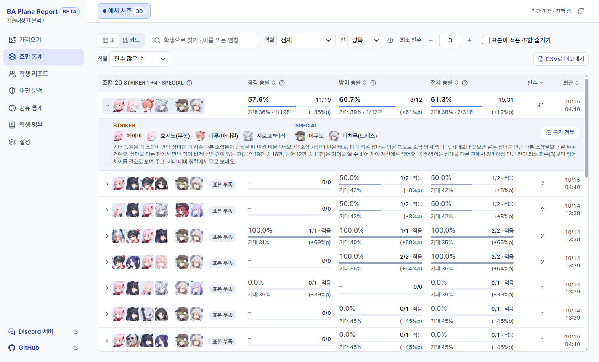

## 개발 목적

전술대항전은 편성을 정해 두면 공격도 방어도 자동으로 싸우는 비동기 PvP입니다. 그래서 승패는 손 컨트롤이 아니라 **어떤 학생을 어떤 순서로 넣느냐**에서 갈립니다.

그런데 게임 안에서는 최근 전투 몇 건의 결과만 볼 수 있습니다. 이런 것들은 알 수 없습니다.

- 이 조합으로 공격하면 몇 판 중 몇 판을 이겼는지
- 내 방어 편성은 어떤 공격 조합에 자주 지는지
- 어떤 학생이 들어간 편성이 실제로 승률이 높은지

전투가 끝날 때마다 양쪽 편성 12명을 손으로 적어 두기는 번거롭고 틀리기도 쉽습니다. 그래서 **전투 리포트를 캡처해서 넣기만 하면** 나머지는 프로그램이 읽어서 쌓아 두게 했습니다. 맵이 바뀌면 유리한 편성도 바뀌기 때문에 시즌마다 따로 볼 수 있게 만들었습니다.

## 주요 기능

### 스크린샷 자동 인식

- 전투 리포트 화면을 창에 끌어 놓거나 `Ctrl`+`V`로 붙여넣으면 바로 읽습니다. 여러 장을 한 번에 넣을 수 있습니다.
- 읽는 항목
  - 양쪽의 **공격/방어** (칼·방패 아이콘)
  - **승패** (Win/Lose)
  - 양쪽 **학생 12명** (STRIKER 4명 + SPECIAL 2명씩, 배치 순서 포함)
  - 학생별 **딜량**
- 창 모드(16:9, 4:3), 전체 화면, 창 크기와 상관없이 읽습니다. 화면 전체를 찍어도, 게임 창만 찍어도, 리포트 부분만 잘라도 됩니다.
- 편성이 없는 "대전 이력" 목록 화면을 넣으면 상세 리포트를 캡처하라고 알려 줍니다.

### 확실하지 않은 것만 물어보기

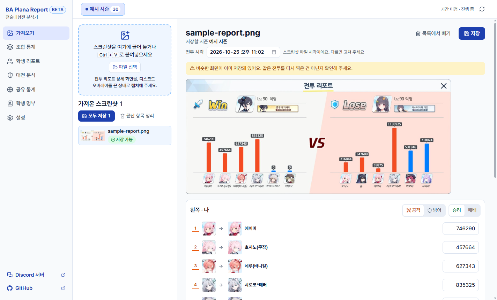

- 확실하게 읽은 칸은 그대로 두고, 애매한 칸만 표시해서 확인을 받습니다.
- 같은 학생의 다른 버전(이격, 예: 호시노 / 호시노(무장))끼리 헷갈리면 후보를 나란히 보여 주고 고르게 합니다.
- 숫자를 읽지 못한 딜량, 확실하지 않은 공격/방어·승패도 확인을 받은 뒤에 저장합니다.
- 직접 확인해 준 초상화는 그 학생의 기준 이미지로 남겨 다음 인식을 돕습니다. 게임 화면의 색이 아이콘과 달라 처음에는 확인이 필요했던 학생도, 한 번 확인하면 다음부터 자동으로 알아봅니다.

### 시즌별 통계

- **시즌 탭**: 전술대항전 시즌마다 탭이 나뉘고, 통계는 탭마다 따로 냅니다. 시즌(이름·기간)은 운영자가 정해 두며, 앱은 처음 한 번 인터넷에서 목록을 받아 둔 뒤 오프라인에서도 씁니다. 오늘 날짜의 시즌(일정이 정해지기 전이면 "기간 미정" 시즌)이 자동으로 선택됩니다.
- **이전 기록**: 예전 버전에서 직접 만든 시즌의 기록은 "이전 기록"으로 보이며, 공식 시즌으로 한 번에 옮길 수 있습니다. 시즌 목록을 받기 전에 저장한 기록은 "임시 기록"에 모였다가 같은 방법으로 옮깁니다.
- **조합 통계**
  - STRIKER 4명은 배치 순서까지, SPECIAL 2명은 순서와 상관없이 같은 조합으로 묶어서 공격·방어·전체 승률과 판수를 보여 줍니다.
  - 한 전투에서 내 조합과 상대 조합이 각각 한 건씩 기록되므로, 상대가 쓴 조합의 승률도 쌓입니다.
  - 판수가 적은 조합은 "표본 부족"으로 표시하고, 숨길 수도 있습니다.
- **기록**: 저장한 전투를 다시 보고, 고치고, 다른 시즌으로 옮기거나 지울 수 있습니다.

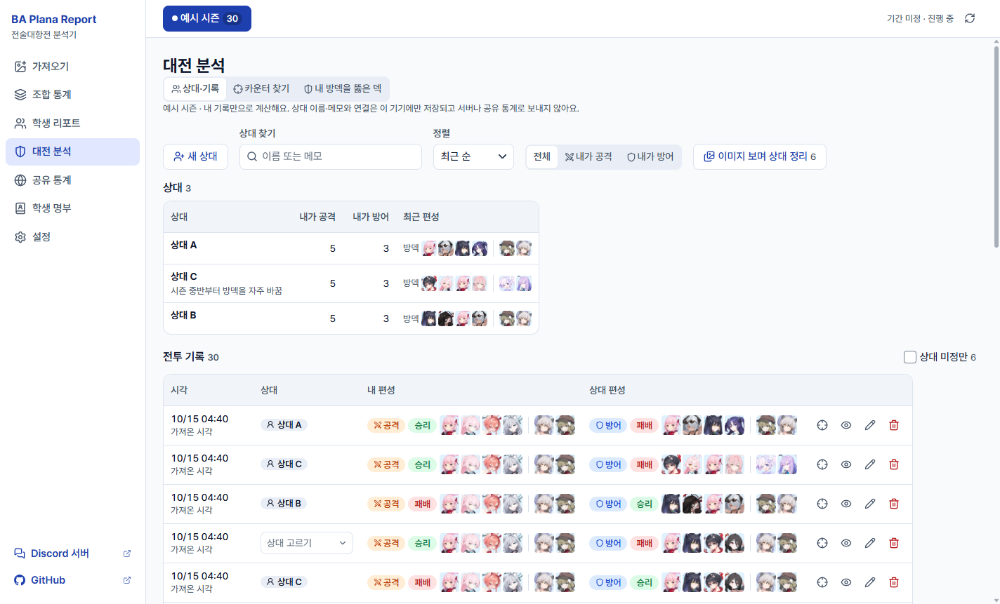

### 학생 리포트

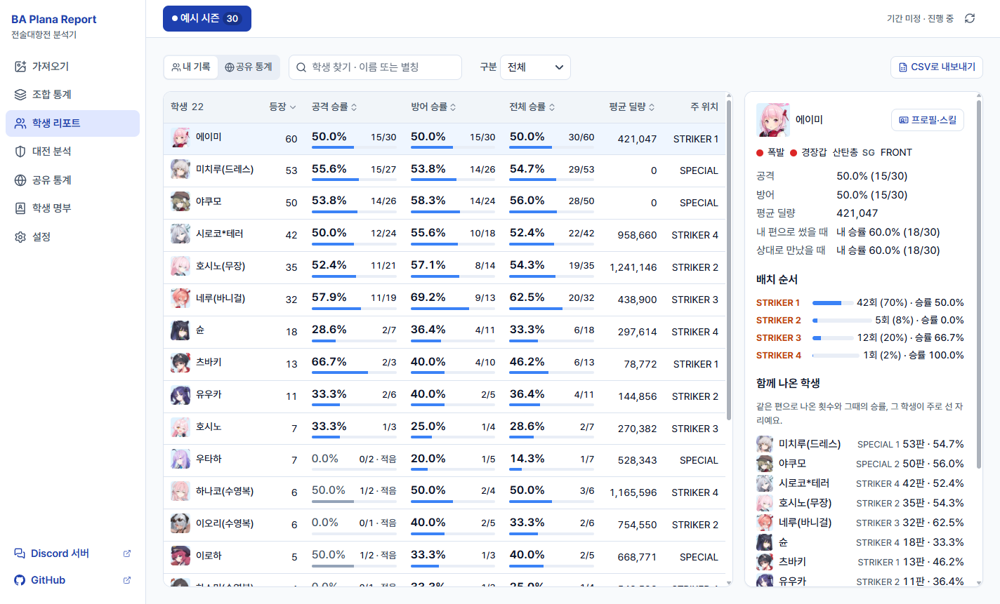

- 학생별 등장 횟수, 공격/방어 승률, 평균 딜량, 주로 배치된 위치를 보여 줍니다.
- 학생을 누르면 세부 지표가 나옵니다.
  - **배치 순서**: STRIKER 1~4, SPECIAL 1·2 중 어디에 얼마나 섰고, 자리마다 승률이 어땠는지
  - **함께 나온 학생**: 같은 편으로 나온 횟수와 그때의 승률, 그 학생이 주로 선 자리
  - **들어간 편성**: 이 학생이 들어간 조합과 승률
  - **내 편으로 썼을 때 / 상대로 만났을 때**: 내 입장에서 본 승률
- "공유 통계" 보기로 바꾸면 여러 사람이 공유한 기록으로 본 학생별 등장률·승률·배치 순서를 볼 수 있습니다([공유 통계](#공유-통계-웹-버전-선택)).

### 방덱 분석

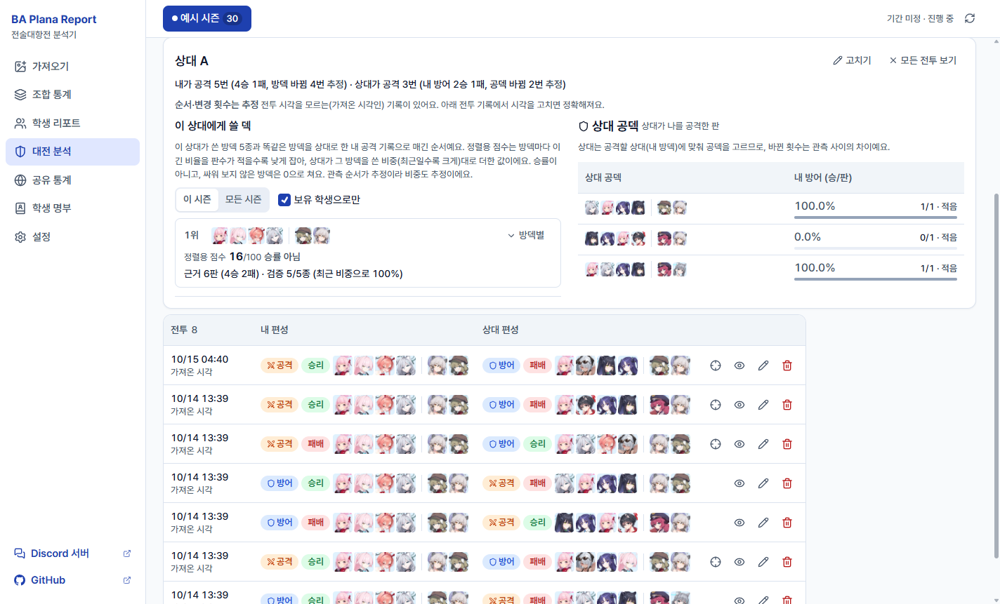

내 기록만으로 기기 안에서 계산합니다.

- **상대별 방덱**: 공격 리포트를 저장할 때(또는 나중에) 상대를 고르거나 새 이름을 붙이면, 그 상대의 최근 방덱 n회와 방덱이 바뀐 것으로 보인 횟수, 내 승패를 보여 줍니다. 닉네임을 읽지 않으므로 상대 이름은 직접 붙이며, 같은 사람으로 확인되면 합칠 수 있습니다. **익명 상대는 한 상대로 묶지 않습니다.** 익명은 여러 사람이 섞이고 켰다 껐다 할 수 있으므로, 누구인지 알면 그 상대에 연결하고 모르면 "익명 · 상대 분석에서 빼기"를 고릅니다. 뺀 공격도 방덱과 승패는 카운터 찾기·통계에 그대로 쓰이며, 앱이 익명이 누구인지 추정하지는 않습니다.
- **이미지 보며 상대 정리**: 이 기능 전에 가져온 기록도, 이 기기에 남은 리포트 이미지에서 상대 프로필 부분(닉네임·대표 학생·배너)만 잘라 크게 보여 주며 상대를 정할 수 있습니다. 프로필 그림이 거의 같은 기록은 같은 상대일 수 있어 한 묶음으로 보여 주므로 묶음째 연결할 수 있고, 방금 연결한 것은 되돌릴 수 있습니다. 묶음은 제안일 뿐이니, 다른 사람이 섞였으면 그 기록만 빼고 연결하세요.
- **이 상대에게 쓸 덱**: 그 상대가 쓴 방덱(최근일수록 비중 크게)과 똑같은 방덱을 상대로 한 내 공격 기록으로 덱을 추천합니다. 방덱마다 판수가 적으면 낮게 잡고, 싸워 보지 않은 방덱은 0으로 쳐서 한쪽 방덱 기록만 많은 덱이 과하게 오르지 않게 합니다. 점수는 순서를 정하는 값이며 승률이 아니므로, 덱마다 검증한 방덱 수와 근거 판수를 함께 보여 줍니다. 이번 시즌 기록이 없으면 모든 시즌 기록을 참고합니다.
- **카운터 찾기**: 고른 방덱과 싸운 내 공격덱을 같은 방덱 / 같은 학생·스트라이커 배치만 다름 / 비슷한 방덱(4~5명 같음, 참고용)으로 나눠 승률과 함께 보여 줍니다. 판수가 적은 100%보다 표본이 큰 높은 승률이 위에 오도록 정렬하고, **학생 명부에서 보유 학생을 체크하면** 지금 짤 수 있는 덱만 골라 볼 수 있습니다.
- **내 방덱을 뚫은 덱**: 내 방덱별 방어 승률과, 그 방덱을 만난 공격덱의 승률(만난 모든 판 기준)을 보여 줍니다.
- 전투 시각은 스크린샷 파일 시각을 기본으로 쓰고, 가져오기·기록 화면에서 고칠 수 있습니다. 시각을 모르는 기록이 섞이면 순서와 변경 횟수를 "추정"이라고 표시합니다.
- 상대 이름·메모는 이 기기에만 저장됩니다([개인정보 보호](#개인정보-보호)).

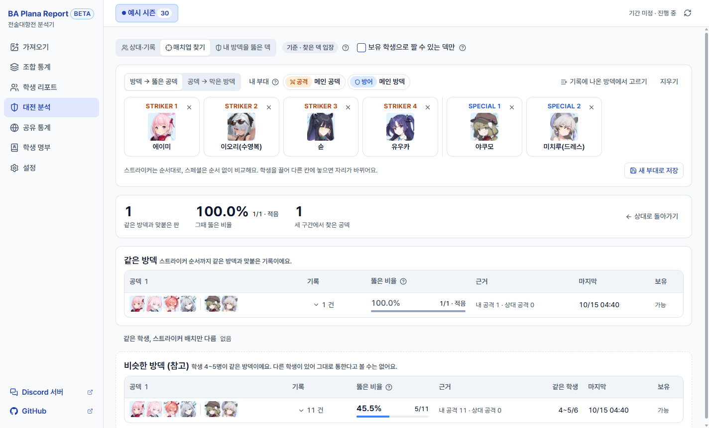

### 학생 프로필과 명부

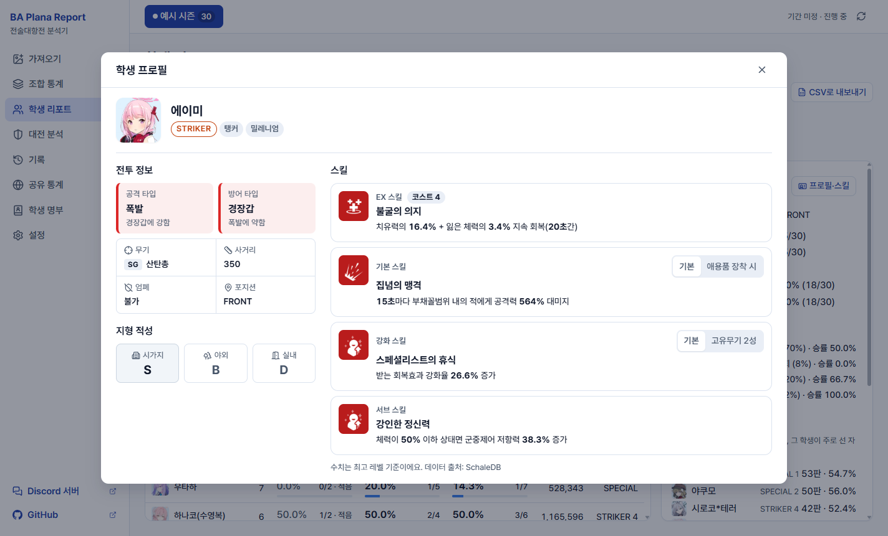

- 학생을 누르면 프로필이 열립니다: 공격·방어 타입(상성 한 줄과 함께), 무기(예: 저격소총 SR), 사거리, 엄폐 가능 여부, 포지션, 역할, 학교, 지형 적성(시가지·야외·실내, S 이상은 강조). 형태가 여럿인 학생은 형태를 골라 볼 수 있습니다.
- **스킬**: EX(코스트 포함)·기본·강화·서브 스킬을 게임 아이콘과 함께 최고 레벨 수치로 보여 주고, 설명 속 수치는 굵게 표시합니다. 애용품·고유무기로 강화된 효과는 카드 안에서 바꿔 볼 수 있습니다.
- **학생 명부**에는 공격·방어 타입과 무기가 함께 나옵니다. 학생마다 별칭을 붙여 검색할 수 있고, **보유 학생**을 체크해 둘 수 있습니다("내 기록에서 찾기"로 내가 쓴 학생을 한 번에 확인). 보유 목록은 로그인하면 계정과 동기화됩니다.
- **기본 별칭**: 운영자가 학생마다 자주 쓰는 별칭을 기본으로 정해 둡니다(점선 칩과 "기본" 표시). 고치면 그 목록이 내 별칭이 되고, "기본값으로"로 되돌릴 수 있습니다. 기본 별칭은 검색에만 쓰고 스크린샷 인식에는 쓰지 않습니다.

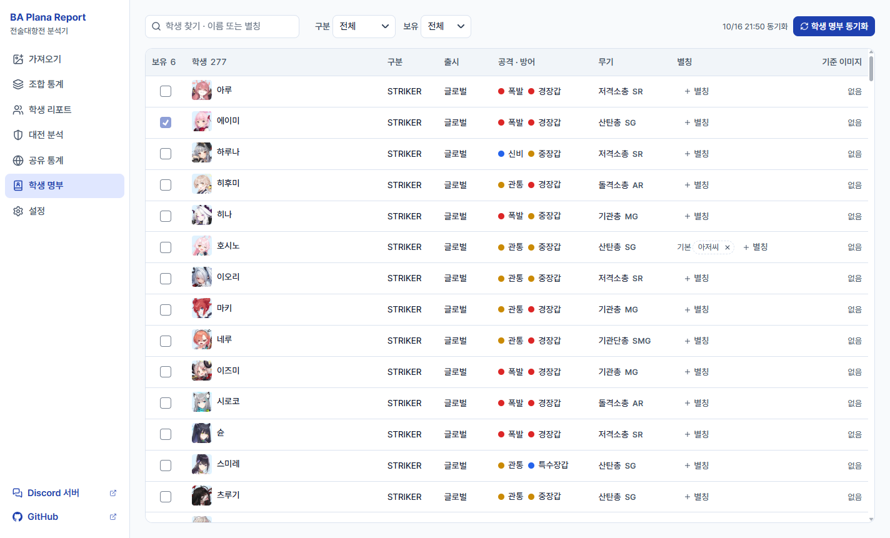

### 공유 통계 (웹 버전, 선택)

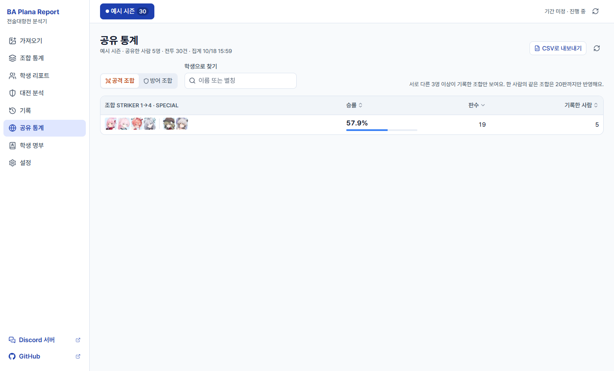

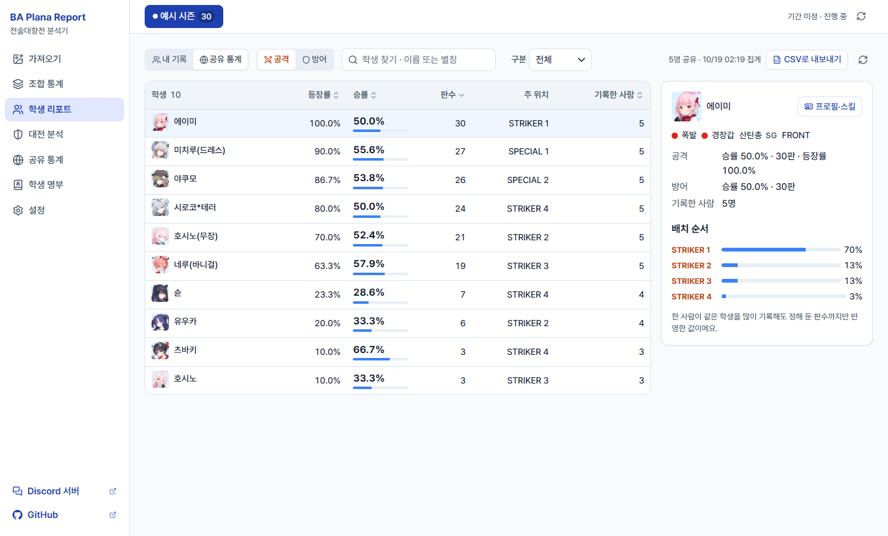

*위 두 화면은 기록을 여러 사람이 나눠 올린 것처럼 만든 예시 데이터입니다.*

- 웹 버전에서 Discord로 로그인한 사람이 **시즌마다 직접 켜면**, 그 시즌 기록이 여러 사람의 기록과 합쳐집니다. 켜지 않으면 들어가지 않습니다.
- 합친 결과는 로그인하지 않아도, 데스크톱 앱에서도 볼 수 있습니다: 역할(공격/방어)별 조합 승률, 학생별 등장률·승률·배치 순서.
- 조작과 쏠림을 막는 규칙
  - 같은 스크린샷은 한 번만, 같은 경기를 양쪽이 각자 올린 것도 한 번만 셉니다(딜량을 모두 읽은 경우).
  - 한 사람이 같은 조합이나 학생을 많이 올려도 20판까지만 반영하고, 한 사람의 시즌 전체 반영량에도 상한이 있습니다.
  - 한 편성에 같은 학생이 둘 들어간 것처럼 있을 수 없는 기록은 뺍니다.
  - **서로 다른 3명 이상**이 기록한 조합·학생만 보여 줍니다.
- 집계는 바뀐 시즌만 다시 합니다(기록이 적으면 10분마다, 많아지면 몇 시간 간격). 공개되는 내용과 제한은 아래 [개인정보 보호](#개인정보-보호)에 정리했습니다.

### 다크 모드와 색상 톤

- 설정의 **화면**에서 라이트·다크를 고르거나 Windows 설정을 따라가게 할 수 있습니다. 창 제목 표시줄도 같이 바뀝니다.
- 색상 톤은 파랑·하늘·보라·분홍·청록·먹색 6가지입니다. 버튼·선택 표시·승률 막대 색이 바뀌고, 승패·공격/방어 표시 색은 어느 톤에서도 그대로입니다.
- 모든 모드와 톤 조합에서 글자 대비가 4.5:1 이상이 되도록 맞췄습니다.

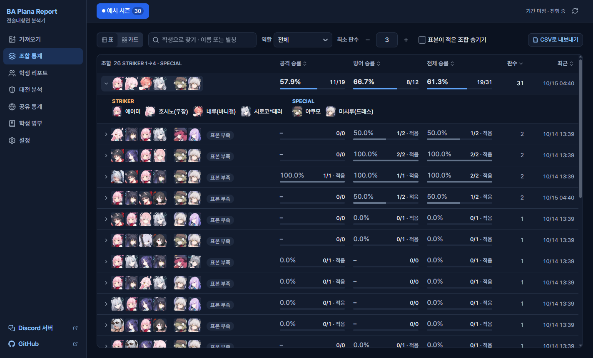

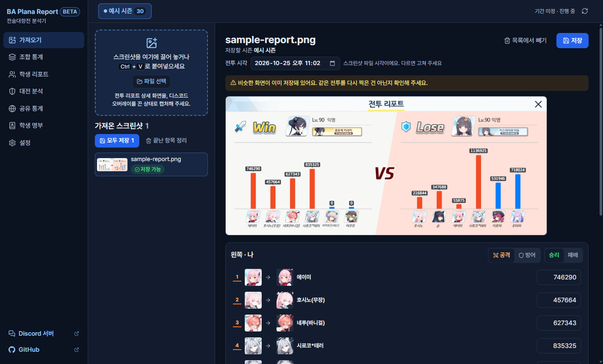

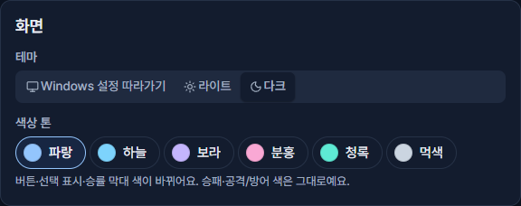

### 그 밖에

- **중복 방지**: 이미 넣은 파일이나 같은 전투(역할·승패·학생·딜량이 모두 같음)를 다시 넣으면 알려 줍니다. 같은 전투를 다른 해상도로 다시 찍은 경우도 찾아냅니다.
- **데이터 이중 저장**: 모든 기록을 실행 파일 옆과 `%APPDATA%` 두 곳에 함께 저장합니다. 한쪽이 지워지거나 손상돼도 다른 쪽에서 복구합니다.
- **백업 파일**: 설정에서 기록·명부·별칭·기준 이미지·설정을 ZIP 파일 하나로 내보내고 되살릴 수 있습니다. 다른 PC로 옮기거나 웹 버전과 데이터를 주고받을 때도 씁니다. 손상되거나 고쳐진 백업 파일은 아무것도 바꾸지 않고 거절합니다.

## 웹 버전

설치 없이 브라우저에서 쓸 수 있는 웹 버전도 있습니다: **<https://plana.report>**

- 기능은 데스크톱 앱과 같습니다. 스크린샷 인식과 이름 글자 인식(OCR)도 브라우저 안에서 처리합니다.
- 로그인하지 않으면 기록은 **그 브라우저 안에만** 저장되고 서버로 보내지 않습니다. 브라우저의 사이트 데이터를 지우거나 다른 브라우저·기기에서 열면 보이지 않으니, 설정의 **백업 파일 만들기**로 가끔 백업해 두세요.
- **Discord로 로그인**(선택)하면 기록이 서버에도 저장돼, 브라우저를 초기화하거나 다른 기기에서 열어도 로그인하면 이어서 쓸 수 있습니다. 같은 기록을 두 기기에서 고치면 나중에 동기화한 쪽이 남고, 지운 기록은 고친 기록보다 우선합니다.
- 서버에 저장한 기록을 다시 받을 때 **합치기**(이 기기 기록도 남김)와 **덮어쓰기**(서버 기록으로 바꿈) 중에서 고를 수 있습니다.
- 기록이 엇갈리지 않도록 한 번에 한 탭에서만 열 수 있습니다. 새 버전이 배포되면, 그 전에 열어 둔 탭은 동기화할 때 새로고침하라고 안내합니다.
- 최신 Chrome·Edge·Firefox·Safari에서 쓸 수 있습니다. 사생활 보호(시크릿) 창에서는 저장소가 막히거나 창을 닫을 때 지워질 수 있습니다.
- 데스크톱 앱과 웹 버전 사이에 기록을 옮기려면 한쪽에서 백업 파일을 만들어 다른 쪽에서 복원하면 됩니다.

## 개인정보 보호

개인정보에 민감한 분도 안심하고 쓸 수 있도록 다음을 제한했습니다.

### 기기 밖으로 보내지 않는 것

- **스크린샷과 이미지는 어디로도 보내지 않습니다.** 인식(이미지 처리·글자 인식)은 전부 PC나 브라우저 안에서 하며, 외부 AI·LLM 서비스를 쓰지 않습니다. 로그인해 동기화해도 이미지는 각 기기에만 남습니다.
- **게임 닉네임을 자동으로 읽지 않습니다.** 전투 기록(텍스트)에도, 서버에도 들어가지 않습니다. 다만 이 기기에 저장되는 리포트 이미지에는 원본 그대로 보입니다.
- **같은 상대 묶음 제안은 그림끼리만 비교합니다.** 이 기기에 저장된 리포트 이미지의 상대 프로필 부분을 기기 안에서 비교하며, 닉네임을 글자로 바꾸지 않습니다. 비교 결과는 저장하거나 보내지 않고, 정리 화면을 닫으면 버립니다. 누구인지는 사용자가 이미지를 보고 정합니다.
- **방덱 분석의 상대 이름·메모는 이 기기에만 저장합니다.** 상대 이름은 사용자가 직접 붙입니다. 이 이름·메모와 "어느 공격이 어느 상대였는지"의 연결은 로컬 백업 파일(ZIP)에는 들어가지만, 서버 동기화·공유 통계·서버 데이터 내려받기에는 들어가지 않으므로 새 기기에서 로그인해도 복구되지 않습니다. 실제 닉네임을 이름으로 적었다면 그 이름이 이 기기와 백업 파일에 남는다는 점에 유의해 주세요.
- **데스크톱 앱에는 계정 기능이 없습니다.** 기록은 PC 안에만 저장됩니다.
- 앱이 인터넷에서 **받기만** 하는 것: 학생 목록·스킬(이 리포의 `data` 브랜치 또는 SchaleDB), 학생 아이콘(SchaleDB), 공식 시즌 목록·기본 별칭·공유 통계(웹 버전 사이트). 이때 내 기록이나 식별 정보를 함께 보내지 않습니다.

### 로그인(웹 버전, 선택)했을 때

- Discord 로그인은 **사용자 ID와 표시 이름만** 받는 최소 권한(`identify`)을 씁니다. 이메일, 참여 중인 서버 목록, 친구 목록은 받지 않고, Discord 접근 토큰도 저장하지 않습니다.
- 서버에 올리는 것: 시즌, 전투 기록(학생·딜량·공격/방어·승패, 전투 시각, 스크린샷 파일의 해시값), 별칭, 보유 학생 목록, 화면·인식 설정, Discord 사용자 ID와 이름
- 올리지 않는 것: 스크린샷과 이미지, 게임 닉네임, 방덱 분석의 상대 이름·메모와 연결, 이메일, 위치 정보
- 서버 기록은 그 계정만 볼 수 있습니다. 다른 사람의 기록을 보는 기능은 앱에도, 관리 화면에도 없습니다. (서버 데이터베이스를 관리하는 운영자는 기술적으로 저장된 기록에 접근할 수 있습니다.)
- 설정에서 언제든 **서버 데이터 파일로 받기**로 내 서버 기록을 내려받을 수 있고, **계정 삭제**를 누르면 서버의 계정과 기록이 바로 지워집니다. 브라우저에 있는 기록은 남습니다.
- 쿠키는 로그인을 유지하는 것 하나(30일)와 로그인 도중 잠깐 쓰는 것 하나(10분)뿐입니다. 광고·분석 도구나 다른 회사의 추적 스크립트는 쓰지 않고, 사이트의 보안 정책(CSP)으로 외부 스크립트가 실행되지 않게 막아 두었습니다.

### 공유 통계에서

- **시즌마다 직접 켜야만** 그 시즌 기록이 들어갑니다. 기본은 꺼져 있습니다.
- 공개되는 것은 여러 사람의 기록을 **합친 숫자뿐**입니다: 조합·학생별 판수, 승률, 등장률, 배치 순서 분포, 그것을 기록한 사람 수.
- 공개하지 않는 것: 누가 올렸는지, Discord 이름, 개별 전투 기록, 딜량, 스크린샷
- 서로 다른 3명 이상이 기록한 조합·학생만 보여 주고, 공유한 사람이 3명보다 적으면 전투 수 같은 합계도 숨깁니다. 참여자를 알아도 한 사람의 활동량을 짐작할 수 없게 하려는 것입니다.
- 공유를 끄거나, 공유한 전투를 지우거나, 계정을 지우면 그 시즌의 공개 통계를 바로 가리고, 다시 계산한 뒤에 빠진 채로 보여 줍니다. 공유는 언제든 끌 수 있습니다(하루 변경 횟수 제한에 세지 않음).
- 집계는 기록이 적으면 10분마다, 많아지면 몇 시간 간격으로 합니다(무료 서버의 하루 사용량 안에서). 시즌이 끝나고 3일이 지나면 그 시즌 통계를 고정하고 새로 공유할 수 없습니다.

### 공개 자료에서

- README의 예시 화면에서 플레이어 닉네임은 게임의 익명 표기처럼 "익명"으로 바꿔 두었습니다.
- 버그를 제보할 때 스크린샷을 올린다면 상대 플레이어의 닉네임을 가려 주세요.

## 사용 방법

### 설치

1. [Releases](https://github.com/NXYUI/BA-Combat/releases)에서 `BA-Combat-<버전>-portable.exe`를 받습니다.
2. 원하는 폴더에 두고 실행합니다. 따로 설치할 필요는 없습니다. 실행하면 같은 폴더에 `BA-DATA` 폴더가 생깁니다.

> **Windows의 PC 보호 경고가 뜨면**: 코드 서명이 없는 실행 파일이라 처음 실행할 때 SmartScreen 경고가 나올 수 있습니다. "추가 정보" → "실행"을 누르면 됩니다.

받은 파일이 올린 파일과 같은지 확인하려면, 아래 명령의 결과를 표의 값과 비교하세요(대소문자는 상관없습니다). 릴리스 페이지에서 파일 옆에 표시되는 sha256 값과도 같습니다.

```powershell
Get-FileHash .\BA-Combat-<버전>-portable.exe -Algorithm SHA256
```

| 버전 | SHA256 (`BA-Combat-<버전>-portable.exe`) |
|---|---|
| 0.4.0 | `baf7edd539ed4762ceeebe9a5bff56cbe4907d0132e22f1c18ce5dc105e3b7dd` |
| 0.3.1 | `fd78ea501501df0b8d7e54c56ba31efbb65a2157e7f153bf09e76cdd8670cdab` |
| 0.3.0 | `c786128d92a9c11c19e16c65fde11ac94569a574177d1707c0e56b71dfacaacd` |
| 0.2.0 | `143ec0ccbc1173a39806f20f2c604491dc67abf80227c0d3c2b6e1474a3b8217` |
| 0.1.0 | `5b26cf7e749b23f9f183093dd802b3ff42734ecb745cbd90c88c97fbfc53aee3` |

### 처음 실행했을 때

**학생 명부** 화면에서 **학생 명부 동기화**를 누릅니다. 학생 목록과 아이콘(약 280개)을 받아 와야 초상화를 알아볼 수 있습니다.

### 전투 기록 넣기

1. 게임에서 **전술 대회 → 대전 이력 → 리포트** 버튼을 눌러 전투 리포트 상세 화면을 엽니다.
2. 화면을 캡처합니다 (예: `Win`+`Shift`+`S`).
3. 프로그램의 **가져오기** 화면에 붙여넣거나 이미지 파일을 끌어 놓습니다.
4. 확인할 칸이 표시되면 고르거나 "맞아요"를 누르고 **저장**합니다. 지금 선택된 시즌 탭에 저장됩니다.

### 캡처할 때 참고

- 디스코드 등 화면 위 오버레이는 끄고 찍어 주세요. 초상화나 글자를 가리면 인식이 틀릴 수 있습니다.
- 리포트의 **왼쪽이 항상 캡처한 본인**, 오른쪽이 상대입니다. 공격·방어는 이름 옆 칼·방패 아이콘으로 판별합니다.
- 게임 창이 작을수록 글자와 초상화가 작아집니다. 가능하면 큰 창에서 찍어 주세요.

## 데이터 폴더

| 위치 | 설명 |
|---|---|
| 실행 파일 옆 `BA-DATA` | 기본 저장 위치 |
| `%APPDATA%\BA Combat\BA-DATA` | 같은 내용의 미러 |

- 실행 파일을 다른 폴더로 옮기면, 처음 실행할 때 `%APPDATA%`의 미러에서 기록을 가져옵니다.
- Program Files처럼 쓰기 권한이 없는 폴더에서 실행하면 `%APPDATA%` 쪽만 씁니다.
- 백업은 **설정 → 백업 파일 만들기**로 ZIP 하나를 받아 두면 됩니다. `BA-DATA` 폴더를 통째로 복사해도 됩니다. 백업에서 복원하면 그 전 데이터는 지우지 않고 `BA-DATA` 안의 `before-restore-<시각>` 폴더로 옮겨 둡니다.

| 파일·폴더 | 내용 |
|---|---|
| `data.json` | 전투 기록과 이전 기록(예전에 직접 만든 시즌) |
| `roster.json` | 학생 명부(속성 포함), 내 별칭 |
| `settings.json` | 화면·인식 설정 |
| `official-seasons.json` | 받아 둔 공식 시즌 목록 |
| `opponents.json` | 방덱 분석의 상대 이름·메모와 연결 (이 기기에만, 서버로 보내지 않음) |
| `alias-presets.json` | 받아 둔 기본 별칭 (백업에는 넣지 않음) |
| `student-skills.json` | 받아 둔 학생 스킬 (백업에는 넣지 않음) |
| `battles/` | 저장한 전투 리포트 이미지 |
| `icons/` | 받아 둔 학생 아이콘 |
| `skill-icons/` | 프로필을 열 때 받아 둔 스킬 아이콘 (백업에는 넣지 않음) |
| `refs/` | 직접 확인한 초상화 (기준 이미지) |

## 학생 데이터를 받는 곳

- **학생 목록·스킬**: 이 리포의 [`data` 브랜치](https://github.com/NXYUI/BA-Combat/tree/data)에서 받습니다. GitHub Actions가 매일 SchaleDB의 한국어 학생 데이터를 받아, 앱이 쓰는 필드(이름, STRIKER/SPECIAL, 출시 여부, 공격·방어 타입·무기 같은 프로필 속성, 스킬)만 남겨 올려 둡니다. 이 브랜치를 받을 수 없을 때만 SchaleDB에서 직접 받습니다.
  - 사용자가 늘어도 SchaleDB 서버에 직접 가는 요청이 늘지 않게 하고, SchaleDB의 데이터 형식이 바뀌어도 앱이 깨지기 전에 이 작업에서 걸러지게 하려는 구성입니다.
  - 스킬은 크기가 커서 학생 프로필을 처음 열 때 받습니다.
- **학생·스킬 아이콘**: 같은 `data` 브랜치에 Actions가 올려 둔 그림을 받습니다. 처음 한 번 받은 그림은 다시 받지 않고, 새 학생·스킬 그림만 받아 올립니다. 앱은 학생 아이콘을 처음 명부를 동기화할 때, 스킬 아이콘은 그 학생의 프로필을 처음 열 때 받아 `BA-DATA/icons`, `BA-DATA/skill-icons`(웹 버전은 브라우저 저장소)에 보관합니다. 이 브랜치에 없는 그림만 SchaleDB에서 직접 받습니다.
  - SchaleDB 서버에 가는 요청을 줄이려고 앱이 쓰는 아이콘만 그대로 옮겨 두었습니다. 그림의 권리는 게임 제작사에 있습니다([고지](#고지)).
- 받은 데이터는 크기와 시간에 상한을 두고 모양을 검사한 뒤에만 씁니다. 화면에는 글자로만 보여 주고 HTML로 해석하지 않습니다.

## 인식 방식

외부 AI나 LLM API를 쓰지 않고 이미지 처리만으로 읽습니다.

1. **패널 찾기**: 팝업이 뜨면 게임이 배경을 어둡게 깔기 때문에, 밝은 리포트 패널을 찾아 기준 크기로 맞춥니다. 리포트 화면은 해상도와 관계없이 모양이 같고 크기만 바뀌어서, 한 번 맞추면 나머지는 같은 위치에서 읽을 수 있습니다.
2. **공격/방어·승패**: 칼·방패 아이콘의 모양과 Win 글자의 금색을 봅니다.
3. **학생**: 초상화를 SchaleDB 아이콘과 모양·색으로 비교합니다. 점수가 애매하면 초상화 아래 이름 글자를 읽어(OCR) 공식 이름과 내가 붙인 별칭으로 한 번 더 확인하고, 그래도 확실하지 않으면 사용자에게 묻습니다.
4. **딜량**: 막대 위 숫자를 게임 글꼴의 숫자 모양과 비교해 읽습니다.

## 요구 사항과 한계

- 데스크톱 앱: Windows 10/11 64비트 / 웹 버전: 최신 브라우저
- 한국어 클라이언트(글로벌 서버) 화면으로 만들고 확인했습니다. 일본 서버 학생 목록은 설정에서 고를 수 있지만 일본어 클라이언트 화면은 확인하지 않았습니다.
- 모바일 캡처와 16:9가 아닌 모니터(21:9 등)의 전체 화면 캡처는 아직 확인하지 않았습니다.
- 학생 명부·공식 시즌 목록을 받으려면 인터넷 연결이 필요합니다(한 번 받으면 오프라인에서도 씁니다). 이름 글자 인식용 한국어 데이터는 앱(웹 버전은 사이트)에 함께 들어 있습니다.
- 게임 업데이트로 리포트 화면 구성이 바뀌면 인식이 멈출 수 있습니다. 이때는 "화면 구성이 바뀌었을 수 있다"고 안내합니다.

## 커뮤니티와 문의

공지, 질문, 버그 제보는 [Discord 서버](https://discord.gg/bP3QCEsqsH)에서 받습니다.
버그를 제보할 때 전투 리포트 스크린샷을 올린다면, 상대 플레이어의 닉네임을 가린 뒤 올려 주세요.

## 고지

- 이 프로그램은 팬이 만든 비공식 도구이며 NEXON Games, Yostar와 관계가 없습니다. Blue Archive와 관련 이미지의 권리는 각 권리자에게 있습니다.
- 학생 데이터와 아이콘의 출처는 [SchaleDB](https://schaledb.com)입니다. 모두 이 리포의 `data` 브랜치를 거쳐 실행 중에 받으며(받을 수 없으면 SchaleDB에서 직접), 프로그램(exe)에는 포함하지 않습니다. 아이콘의 권리는 게임 제작사에 있고, 권리자가 요청하면 내립니다.
- README의 예시 화면에서 플레이어 닉네임은 게임의 익명 표기처럼 "익명"으로 바꿔 두었습니다. 공유 통계 화면은 예시 데이터입니다.
- 사용한 오픈소스: [Pretendard](https://github.com/orioncactus/pretendard) (SIL OFL 1.1), [Tesseract.js](https://github.com/naptha/tesseract.js) (Apache-2.0), Electron, React

## 라이선스

[MIT](LICENSE)
